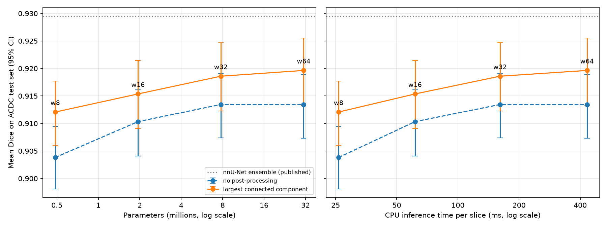
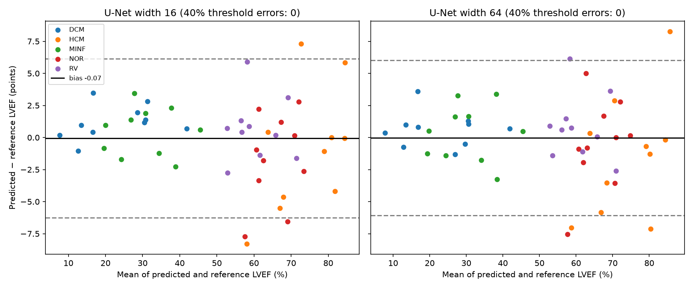
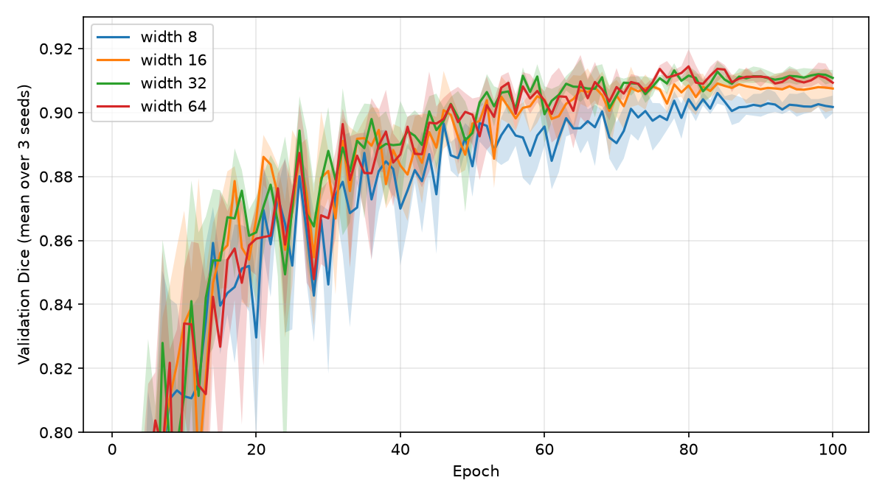
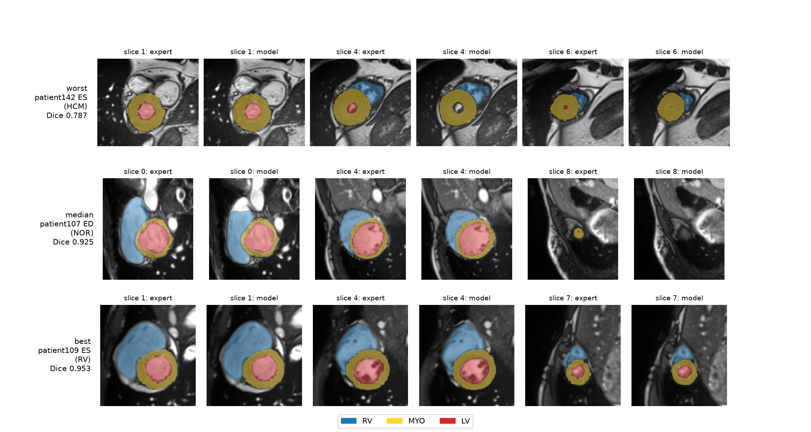

# Cardiac MRI segmentation (ACDC): how much accuracy does a compact U-Net keep under a tight compute budget?

A 2D U-Net with **1.9 M parameters** (16× smaller than a standard U-Net) segments the right ventricle, myocardium and left ventricle on the official ACDC test set with a **mean Dice of 0.915**, within **0.4 Dice points** of a 31 M-parameter U-Net, while running **7× faster on CPU** and training in **14 minutes on a free Colab GPU**. On the clinical measurement derived from the segmentation, the left-ventricular ejection fraction (LVEF), model size makes **no measurable difference**: every model estimates LVEF within about 2.3 points of the expert on average, and none classifies a patient on the wrong side of the 40% threshold.



*Mean test Dice (95% patient-level bootstrap CI) against parameter count and CPU inference time, both on log scales. Note that the vertical axis spans only 3 Dice points. The CIs of individual models overlap because they include between-patient variability; the paired comparisons in the results table remove it, since a difficult patient is difficult for every model. Dotted line: published nnU-Net ensemble, for reference only (see [Comparison with the state of the art](#comparison-with-the-state-of-the-art)).*

## Contents

- [Motivation](#motivation)
- [Key results](#key-results)
- [Data](#data)
- [Method](#method)
- [Evaluation protocol](#evaluation-protocol)
- [Detailed results](#detailed-results)
- [Comparison with the state of the art](#comparison-with-the-state-of-the-art)
- [Findings](#findings)
- [Limitations](#limitations)
- [Reproducing the results](#reproducing-the-results)
- [Repository structure](#repository-structure)
- [Citation and license](#citation-and-license)

## Motivation

Algorithms intended for medical devices often have to run on modest hardware, and many research groups train models without dedicated GPUs. This project asks a simple engineering question: **what is the trade-off between segmentation accuracy, model size and computational cost** for cardiac MRI segmentation, when the whole project is limited to a CPU laptop and a free-tier cloud GPU?

To answer it, the same U-Net is trained at four widths (8, 16, 32 and 64 channels in the first level, from 0.49 M to 31 M parameters), each with three random seeds, and evaluated on segmentation accuracy, a derived clinical measurement (LVEF), training time and inference time.

## Key results

All numbers are measured on the 50 patients of the official ACDC test set (100 volumes: end-diastole and end-systole), with largest-connected-component post-processing, averaged over 3 seeds.

| Width | Params | Training time (T4 GPU) | Inference (CPU, per slice) | Mean Dice [95% CI] | Δ Dice vs width 64 [95% CI] | LVEF MAE (points) [95% CI] |
|---|---|---|---|---|---|---|
| 8 | 0.49 M | 14.9 min | 25.9 ms | 0.912 [0.906, 0.918] | −0.008 [−0.009, −0.006] | 2.31 [1.82, 2.81] |
| **16** | **1.94 M** | **14.2 min** | **61.5 ms** | **0.915 [0.909, 0.921]** | **−0.004 [−0.006, −0.003]** | **2.42 [1.88, 3.02]** |
| 32 | 7.76 M | 15.6 min | 161.2 ms | 0.919 [0.912, 0.925] | −0.001 [−0.002, +0.000] | 2.17 [1.60, 2.80] |
| 64 | 31.04 M | 28.9 min | 432.0 ms | 0.920 [0.913, 0.926] | reference | 2.28 [1.73, 2.85] |

In short:

- **Accuracy barely depends on size.** Going from 31 M to 1.9 M parameters costs 0.4 Dice points; going down to 0.49 M costs 0.8 points. These gaps are statistically detectable with a paired bootstrap but small in absolute terms. Beyond width 32, adding parameters brings no significant gain.
- **Cost grows quickly.** CPU inference time grows by roughly 2.5× per doubling of width (26 → 62 → 161 → 432 ms per slice).
- **Training time does not follow parameter count.** Widths 8, 16 and 32 all train in about 15 minutes on a T4 GPU; only width 64 doubles. Small models do not saturate the GPU, so other costs (data loading on two CPU cores, per-epoch validation, kernel launches) dominate. Parameter count alone does not predict real cost: it has to be measured.
- **The clinical measurement is unaffected.** LVEF error is about 2.2 to 2.4 points for every width, with overlapping CIs.

## Data

[ACDC](https://www.creatis.insa-lyon.fr/Challenge/acdc/) (Automated Cardiac Diagnosis Challenge, MICCAI 2017): cine MRI short-axis stacks from the University Hospital of Dijon, with expert annotations of the right ventricle cavity (RV), left ventricle myocardium (MYO) and left ventricle cavity (LV) at end-diastole (ED) and end-systole (ES). Patients are evenly split into five groups: normal (NOR), previous myocardial infarction (MINF), dilated cardiomyopathy (DCM), hypertrophic cardiomyopathy (HCM) and abnormal right ventricle (RV).

| Split | Patients | Source |
|---|---|---|
| Train | 90 | `training/`, stratified by pathology group (18 per group) |
| Validation | 10 | `training/`, 2 per group (seed 42) |
| Test | 50 | official `testing/` set, never used for any decision |

Splits are made **by patient**, never by slice, to avoid leakage. The split is versioned in [`configs/split.json`](configs/split.json). The data itself is not redistributed in this repository (see [Citation and license](#citation-and-license)).

## Method

### Preprocessing ([`scripts/prepare_data.py`](scripts/prepare_data.py))

1. **Intensity normalization** per volume: clipping to the 0.5–99.5 percentiles, then z-score.
2. **In-plane resampling to 1.25 mm** (native spacing ranges from about 1.37 to 1.68 mm), linear interpolation for images and nearest neighbor for masks, so that one pixel has the same physical size for every patient. The slice axis is left untouched (5 or 10 mm spacing); its true spacing is stored for volume computations.
3. **Center crop or pad to 256 × 256 pixels** (320 mm field of view).

**Why 320 mm and not a tighter crop.** The initial plan was a 128 × 128 crop (160 mm) centered on the image. A check on all 300 annotated volumes ([`scripts/check_crop.py`](scripts/check_crop.py), results in [`results/preprocessing/`](results/preprocessing/)) showed that this assumption was wrong: the heart can sit up to 93 mm away from the image center, and a centered 160 mm crop would have cut off up to **50%** of the heart (patient046), with a quarter of the volumes losing at least 1.5%. A 320 mm field of view keeps **100%** of the annotated heart in every volume. Cropping around the ground-truth mask was ruled out, since the mask is not available at inference time.

Resampling alone changes the reference LVEF by only **0.16 points** on average (expert masks, resampled vs original resolution).

### Training ([`src/train.py`](src/train.py))

- **Model**: 2D U-Net, depth 4 (inputs must be divisible by 16), two 3 × 3 convolutions with BatchNorm and ReLU per block, max pooling, transposed convolutions, skip connections. Channel widths are `w × (1, 2, 4, 8, 16)` with `w ∈ {8, 16, 32, 64}`; width 64 corresponds to the original U-Net configuration.
- **Patch-based training**: random 128 × 128 patches, two thirds of them centered on a randomly chosen cardiac pixel, one third sampled anywhere. Since the U-Net is fully convolutional, the model trained on patches is applied to full 256 × 256 slices at inference. This keeps the training cost of a 128 × 128 input while handling off-center hearts.
- **Augmentations**: rotation (±20°), random 90° rotations and flips (orientation varies across scanners), contrast and brightness jitter, occasional Gaussian noise. Elastic deformations were left out to keep the data pipeline fast on two CPU cores.
- **Loss**: cross-entropy + soft Dice on the foreground classes, pooled over the batch so that patches missing a structure do not destabilize the loss.
- **Optimization**: AdamW (lr 1e-3, weight decay 1e-4), cosine schedule, 100 epochs of 2,000 patches, batch size 16, mixed precision, on a free Colab T4 GPU. The same budget is used for every width.
- **Model selection**: checkpoint with the best mean validation Dice, computed on full validation volumes.

### Inference ([`src/inference.py`](src/inference.py))

Full slices are segmented one by one, then **only the largest 3D connected component of each class is kept**. This post-processing removes small false-positive islands far from the heart (for instance in the stomach). The decision to use it was taken on the validation set, where it improved all three structures for every width (RV +0.7 to +0.9 points, LV +0.3 to +0.6, MYO +0.1 to +0.5). Results without post-processing are reported as well.

## Evaluation protocol

- **Dice** is computed **per 3D volume** (all slices pooled), per structure. A per-slice average would give tiny apical slices as much weight as large basal ones.
- **Aggregation**: one score per patient (mean of ED and ES) and per width (mean of the 3 seeds).
- **Confidence intervals**: 2,000 bootstrap resamples **of patients** (not of volumes, since ED and ES of the same patient are not independent). The same resamples are used for every model, which gives **paired** comparisons for the differences with width 64.
- **Training variability**: standard deviation of the mean test Dice across the 3 seeds, reported separately.
- **LVEF**: reference LVEF is computed from the original expert masks at native resolution; predicted LVEF from the model's LV volumes. Metrics: mean absolute error, bias and 95% limits of agreement (Bland-Altman), Pearson correlation, and the number of patients classified on the wrong side of the 40% threshold used in the ACDC group definitions.
- **Timing**: CPU inference time per slice on the same machine for every model, after warm-up runs. Training time is wall-clock time on a Colab T4 GPU, validation included.

The test set was used once, after all methodological choices were frozen.

## Detailed results

### Segmentation (test set, 3 seeds)

With largest-connected-component post-processing:

| Width | RV | MYO | LV | Mean [95% CI] | Seed SD |
|---|---|---|---|---|---|
| 8 | 0.906 | 0.892 | 0.939 | 0.912 [0.906, 0.918] | 0.001 |
| 16 | 0.908 | 0.898 | 0.940 | 0.915 [0.909, 0.921] | 0.001 |
| 32 | 0.913 | 0.900 | 0.943 | 0.919 [0.912, 0.925] | 0.001 |
| 64 | 0.913 | 0.902 | 0.944 | 0.920 [0.913, 0.926] | 0.000 |

Without post-processing:

| Width | RV | MYO | LV | Mean [95% CI] | Δ vs width 64 [95% CI] |
|---|---|---|---|---|---|
| 8 | 0.897 | 0.880 | 0.934 | 0.904 [0.898, 0.909] | −0.010 [−0.012, −0.007] |
| 16 | 0.903 | 0.890 | 0.938 | 0.910 [0.904, 0.916] | −0.003 [−0.005, −0.001] |
| 32 | 0.908 | 0.892 | 0.940 | 0.913 [0.907, 0.919] | +0.000 [−0.002, +0.002] |
| 64 | 0.907 | 0.893 | 0.940 | 0.913 [0.907, 0.919] | reference |

Full per-volume results: [`results/test_per_volume.csv`](results/test_per_volume.csv). Summary: [`results/summary_test.csv`](results/summary_test.csv).

### Ejection fraction (test set, 3 seeds)

| Width | LVEF MAE (points) [95% CI] | Bias | Limits of agreement | Correlation | EDV error | ESV error | Wrong side of 40% |
|---|---|---|---|---|---|---|---|
| 8 | 2.31 [1.82, 2.81] | +0.18 | [−5.31, +5.68] | 0.992 | 5.0 mL | 4.8 mL | 0 / 50 |
| 16 | 2.42 [1.88, 3.02] | −0.07 | [−6.27, +6.13] | 0.990 | 4.6 mL | 4.7 mL | 0 / 50 |
| 32 | 2.17 [1.60, 2.80] | −0.41 | [−6.33, +5.50] | 0.991 | 4.9 mL | 4.4 mL | 0 / 50 |
| 64 | 2.28 [1.73, 2.85] | −0.03 | [−6.08, +6.01] | 0.990 | 4.6 mL | 4.5 mL | 0 / 50 |



*Bland-Altman plots of predicted vs reference LVEF, colored by pathology group. Errors are smallest for low-EF patients (DCM, MINF) and largest for high-EF patients (HCM, NOR).*

### Learning curves



*Validation Dice per epoch, mean over 3 seeds (shaded: min–max). All widths reach a plateau around epoch 80. Width 8 plateaus about one point lower and varies more across seeds.*

### Qualitative examples



*Worst, median and best test volumes for the compact model (width 16, seed 0), selected automatically by mean Dice. For each, the first, middle and last slices containing LV cavity are shown, expert annotation next to model prediction.*

## Comparison with the state of the art

The `testing/` folder contains the 50 patients of the official challenge test set, so published results refer to the same patients. On this test set, nnU-Net (Isensee et al., 2021) reports a mean Dice of 0.9295 (RV 0.9295, MYO 0.9183, LV 0.9407).

| | RV | MYO | LV | Mean |
|---|---|---|---|---|
| nnU-Net ensemble (published) | 0.930 | 0.918 | 0.941 | 0.930 |
| This work, width 16 | 0.908 | 0.898 | 0.940 | 0.915 |
| This work, width 64 | 0.913 | 0.902 | 0.944 | 0.920 |

The compact model is 1.5 points below nnU-Net on average and on par on the LV cavity, the structure used for LVEF. On LVEF, its correlation with the expert (0.990) is in the range reported by the challenge winners on the same patients. This comparison is indicative only:

- nnU-Net is an **ensemble** of 2D and 3D networks trained with 5-fold cross-validation on all 100 training patients; this work uses a single 2D network trained on 90 patients for 14 minutes;
- published scores are computed by the official evaluation platform at native resolution, separately for ED and ES; scores here are computed on the 1.25 mm resampled grid.

nnU-Net is used here as an **upper reference**, not as a competitor: the contribution of this project is the accuracy–cost curve.

## Findings

**What works.**

- A 1.9 M-parameter U-Net is enough for this task: it is within 0.4 Dice points of a 16× larger model and estimates LVEF just as well, with no patient misclassified at the 40% threshold.
- Checking assumptions pays off: the centered-crop assumption was false for about a quarter of the volumes. Patch-based training on a 320 mm field of view solved the problem without increasing training cost.
- Largest-connected-component post-processing is a cheap, consistent gain (+0.5 to +0.8 Dice points on test), validated on the validation set beforehand.

**Where the models fail.** Errors concentrate where structures are tiny:

- **End-systole in HCM patients**: a very thick myocardium leaves an almost obliterated LV cavity of a few pixels, which models tend to miss (worst test volume: Dice 0.787).
- **Apical slices**: the smallest rings of myocardium at the apex are sometimes not predicted at all.
- The same patients are poorly measured by every model, whatever its width: these errors come from case difficulty, not from model capacity. Across the 100 test volumes, no catastrophic failure was observed.

**Clinically relevant behavior.** LVEF errors are smallest for low-EF patients (DCM, MINF), mostly within ±3.5 points, where the reduced-EF decision is made. Larger errors occur for high-EF patients, mostly HCM, whose small end-systolic cavity makes a few mL of volume error translate into several EF points; these patients remain far above the 40% threshold.

**What does not work (or not as expected).**

- Reducing model size does **not** reduce GPU training time below width 32: the bottleneck is elsewhere in the pipeline.
- Post-processing can slightly **hurt the myocardium** near the base, where the ring may be incomplete and split into several components.

## Limitations

- **2D model**: slices are segmented independently, without 3D context.
- **Single center, single expert**: ACDC comes from one hospital and each volume has one reference annotation; generalization to other scanners or centers is not tested.
- **Small validation set** (10 patients): checkpoint selection relies on a noisy signal.
- **Timing**: CPU inference time is measured on a single laptop (AMD Ryzen 5 5625U, 2.30 GHz); absolute values depend on the hardware, only relative comparisons between widths are meaningful. GPU training times were measured on Colab T4 virtual machines, which may vary between sessions (one width-8 run took 976 s against about 850 s for the other two).
- **GPU nondeterminism**: some cuDNN operations are not deterministic, so re-running with the same seed may differ slightly (well below seed-to-seed variability).
- **Comparison with published results** uses a slightly different evaluation pipeline (see above).

## Reproducing the results

### 1. Environment

```bash
conda create -n acdc python=3.12 -y
conda activate acdc
pip install torch --index-url https://download.pytorch.org/whl/cpu   # or the CUDA build on a GPU machine
pip install -r requirements.txt
```

### 2. Data

Download ACDC from the [official page](https://www.creatis.insa-lyon.fr/Challenge/acdc/databases.html) and place the `training/` and `testing/` folders in `data/raw/`. Then:

```bash
python scripts/check_crop.py      # optional: field-of-view check
python scripts/prepare_data.py    # writes data/processed/*.npz and configs/split.json
```

### 3. Training (GPU)

```bash
python -m src.train --width 16 --seed 0 --epochs 100 --out-dir runs
```

The full ablation runs every width in {8, 16, 32, 64} with seeds {0, 1, 2}. Finished runs (with a `summary.json`) are skipped, so the loop can be resumed after a Colab disconnection. For Colab, compress `data/processed/` into a zip on Google Drive, clone the repository in the notebook, unzip the data to the local disk and write runs to Drive.

### 4. Evaluation and figures (CPU)

```bash
python -m src.evaluate                                                  # test set, per-volume CSV
python -m src.evaluate --split val --out results/val_per_volume.csv     # post-processing decision
python scripts/summarize.py                                             # table with bootstrap CIs
python scripts/ef_analysis.py                                           # LVEF analysis and Bland-Altman
python scripts/make_figures.py                                          # README figures
```

All random generators are seeded; the bootstrap uses a fixed seed.

## Repository structure

```
acdc-compact-unet/
├── configs/split.json          # patient-level train/val/test split
├── scripts/
│   ├── inspect_data.py         # dataset statistics
│   ├── check_crop.py           # field-of-view check
│   ├── prepare_data.py         # preprocessing and split
│   ├── check_dataset.py        # visual check of training patches
│   ├── check_model.py          # parameter counts and forward pass
│   ├── check_loss.py           # sanity checks of the loss
│   ├── show_runs.py            # validation summary of all runs
│   ├── summarize.py            # test table with bootstrap CIs
│   ├── ef_analysis.py          # ejection fraction analysis
│   └── make_figures.py         # figures
├── src/
│   ├── dataset.py              # patch dataset and augmentations
│   ├── model.py                # U-Net with configurable width
│   ├── losses.py               # Dice + cross-entropy loss
│   ├── inference.py            # volume prediction, Dice, post-processing
│   ├── train.py                # training loop
│   ├── evaluate.py             # test-set evaluation
│   └── utils.py                # seeding
└── results/
    ├── preprocessing/          # crop checks
    ├── figures/
    ├── test_per_volume.csv
    ├── val_per_volume.csv
    ├── summary_test.csv
    └── ef_summary.csv
```

Data (`data/`) and model weights (`runs/`, `*.pt`) are not versioned.

## Citation and license

**Dataset.** Any use of ACDC must cite:

> O. Bernard, A. Lalande, C. Zotti, F. Cervenansky, et al. "Deep Learning Techniques for Automatic MRI Cardiac Multi-structures Segmentation and Diagnosis: Is the Problem Solved ?" in *IEEE Transactions on Medical Imaging*, vol. 37, no. 11, pp. 2514-2525, Nov. 2018. doi: [10.1109/TMI.2018.2837502](https://doi.org/10.1109/TMI.2018.2837502)

The ACDC data is distributed under its own license terms (see `LICENSE_TERMS.md` in the official archive) and is not included in this repository.

**Reference method.** F. Isensee, P. F. Jaeger, S. A. A. Kohl, J. Petersen, K. H. Maier-Hein. "nnU-Net: a self-configuring method for deep learning-based biomedical image segmentation." *Nature Methods*, 18, 203–211, 2021.

**Code.** Released under the MIT License (see [`LICENSE`](LICENSE)).

**Author.** Raphael Cerveau, [@Raphael-Crv](https://github.com/Raphael-Crv)